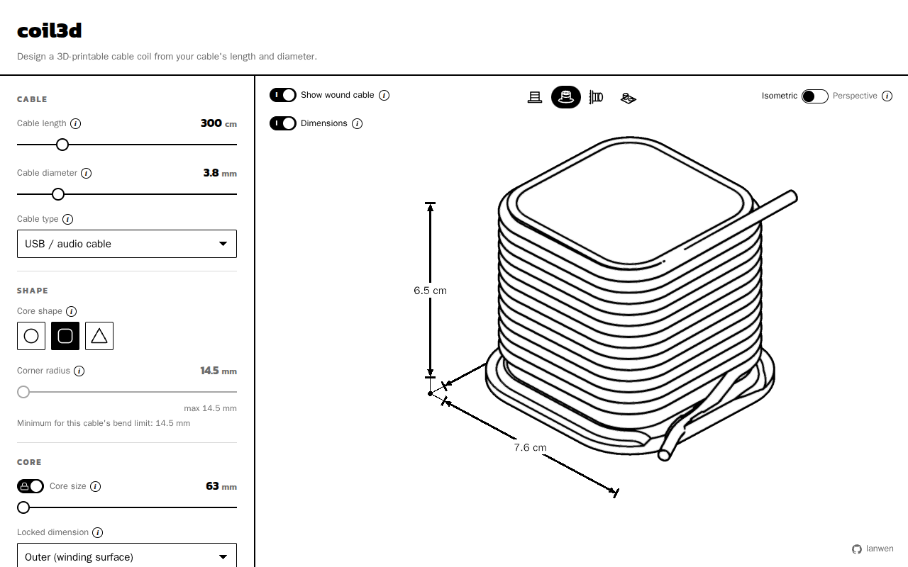

# coil3d

Design a 3D-printable cable coil from your cable's length and diameter.

**Live app: <https://coil3d.lanwen.dev>**



You enter how long and how thick the cable is. coil3d works out the size of
the coil, shows it in an IKEA-instruction style with the wound cable, and
exports files you can print. Everything runs in your browser. There is no
server and no account. The full configuration is in the URL, so you can share
a design by sharing the link.

## Features

- Round, rounded-square and rounded-triangle cores, from USB cables up to
  15 m mains cords.
- A solver: lock what you know (core size, height, layers) and it fills in the
  rest. It checks the cable's minimum bend radius and warns when a design
  cannot hold the cable.
- Parts that print flat without supports. The default is a bare core, one
  part with a thin ring and a centre hole at each end where the cable ends
  run in. A base plate, and a top cap with a press, bayonet or snap joint and
  an optional engraved label, are options. A wall mount adds the base.
- Wall mounts: screw keyhole, through holes, or IKEA SKÅDIS rim clips or
  twist-lock T-clips (not affiliated with IKEA). See [docs/mounts.md](docs/mounts.md).
- A step-by-step assembly guide and a print-layout view.
- Export as **STL**, **3MF** (all parts laid out on the plate) or **STEP**.
  The STEP engine is large, so it loads only when you ask for a STEP file.

## Run it

You need Node.js 22 or newer and pnpm 10 (`corepack enable` picks the version pinned in `package.json`).

```sh
pnpm install
pnpm dev        # dev server on http://localhost:5182
pnpm build      # typecheck and production build
pnpm preview    # serve the production build on :5182
```

## Test it

```sh
pnpm exec tsc -b                         # typecheck
pnpm test                                # vitest: the core's public interface
E2E_PORT=5183 pnpm exec playwright test  # end to end; builds and previews on E2E_PORT
```

The end-to-end tests need a Chromium (`pnpm exec playwright install chromium`, or
set `PLAYWRIGHT_CHROMIUM_PATH`). They build and preview the app themselves, so
no dev server needs to run first. See [CONTRIBUTING.md](CONTRIBUTING.md) for
the full merge gate.

## How it works

- `src/core` is a headless library with a small public interface:
  `parseHash`/`toHash`, `design(spec)` and `exportDesign(design, format)`.
  It never imports React or three.js.
- `src/geometry` runs the core in a Web Worker. `src/viewer` draws the result.
- Stack: TypeScript, Vite, React, react-three-fiber, [manifold-3d](https://github.com/elalish/manifold)
  for meshes, and [replicad](https://github.com/sgenoud/replicad)
  (OpenCascade WASM) for STEP.

More detail:

- [docs/design.md](docs/design.md): decisions, capacity math, geometry, the URL
  format and the renderer.
- [docs/mounts.md](docs/mounts.md): the mount designs and the SKÅDIS and
  openGrid facts.
- [docs/step-notes.md](docs/step-notes.md): pitfalls of the STEP export.

## Contributing

See [CONTRIBUTING.md](CONTRIBUTING.md).

## License

coil3d is released under the [MIT License](LICENSE).

The OpenCascade WASM used for STEP export is licensed under LGPL-2.1. It ships
as a separate file that you can replace. The Archivo Black font used for
labels and the Kanit font of the interface (served from the app's own files,
not from Google) are licensed under the SIL Open Font License 1.1. See
[THIRD_PARTY_NOTICES.txt](public/THIRD_PARTY_NOTICES.txt) (also served by the
app at `/THIRD_PARTY_NOTICES.txt`) for these and all other third-party
licenses. [docs/occt-source.md](docs/occt-source.md) explains where to get the
OpenCascade corresponding source and how to rebuild the WASM.
